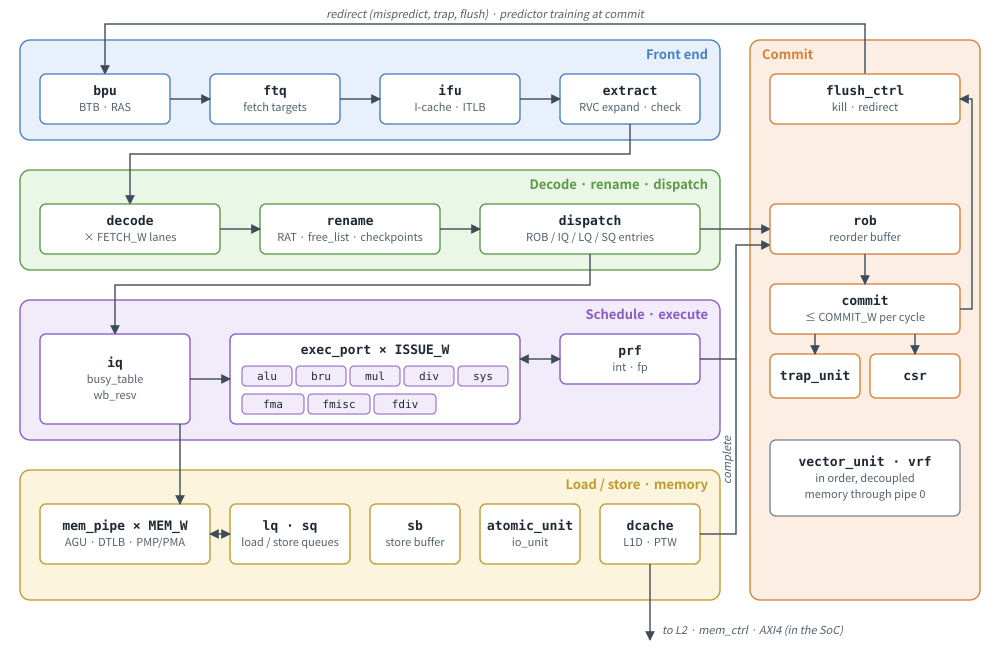

# Architecture

This chapter describes the structure of the core and where each part lives in
the source tree. The sizes quoted here are those of the two supported
configurations; see [Configuration](configuration.md) for the full set.

## Overview

The core is a pipeline of stages joined by small queues. A branch predictor runs
ahead of instruction fetch, decoded operations are renamed onto physical
registers, wait in issue queues until their operands are ready, execute out of
order, and retire in order from the reorder buffer.

Everything outside the core proper (L2, `mem_ctrl`, the memory bus, CLINT, PLIC,
UART and the Debug Module) lives in the SoC, `heliodor_soc_smp`. See
[SoC integration](soc-integration.md).

## Front end

| Module | Role |
|---|---|
| `bpu` | Block predictor: a block-indexed branch target buffer with a return address stack. Branch direction is predicted by a bimodal predictor (a 2-bit saturating counter per branch slot, no global history). It predicts one fetch block per cycle. |
| `ftq` | Fetch target queue. A ring of fetch-block descriptors that also holds the prediction metadata and the predictor checkpoint of each block, and supplies PCs to the branch units. |
| `ifu` | Fetch: ITLB lookup, I-cache request and response, and a fetch buffer. |
| `extract` | Finds instruction boundaries in a fetch block, expands compressed instructions, and checks the predictor's claims against the real instruction stream. A wrong prediction becomes a pre-decode redirect, never a mis-decoded instruction. |

The predictor and the fetch pipeline are decoupled by the FTQ, so a taken-branch
bubble in the predictor is hidden as long as the queue has entries. The predictor
is trained at commit. The front end is restarted by exactly two kinds of
redirect: one from the back end (a mispredict, a trap, a flush) and one from
`extract`.

The L1 instruction cache is 32 KiB, 4-way, with 64-byte lines. Its demand read
is a registered-address SRAM access that reads the four ways in parallel. It is filled coherently through the L2, so
self-modifying code needs only `fence.i`.

## Decode, rename and dispatch

| Module | Role |
|---|---|
| `decode` | One instance per lane: instruction decode, operation class, and legality checks (privilege, state, extension enables). |
| `rename` | Speculative and architectural register alias tables, dependency resolution inside a rename group, checkpoints (`NUM_CKPT`) for fast recovery, and a walk-based recovery as fallback. |
| `free_list` | Free physical registers, one list per register class. |
| `dispatch` | Allocates ROB, load queue, store queue and issue-queue entries for a group, and can accept a group partially when a resource runs out. |

Each queue between stages is a `lane_queue` or a `stage_reg`, so adding a stage
changes only its two neighbours.

## Scheduler and execution

| Module | Role |
|---|---|
| `iq` | Issue queue: wakeup and a tree-structured select. A configuration has one or more queues; each execution port is fed by one queue. |
| `busy_table` | Per-physical-register ready bits. |
| `wb_resv` | Reservation table of write-back slots, one per write-back port, so that variable-latency units never collide on a port. |
| `prf` | Multi-ported register file, instantiated for the integer and the floating-point class. |
| `exec_port` | One issue port: register read, bypass selection, the port's set of functional units, and the write-back packet. |
| `fu_alu`, `fu_bru`, `fu_mul`, `fu_div`, `fu_sys` | Integer units. |
| `fu_fma`, `fu_fmisc`, `fu_fdiv` | Floating-point units. |

Which functional units sit on which port, and which issue queue feeds which
port, is part of the configuration (`PORT_FU` and `PORT_IQ`). All functional
units follow one contract, so adding a unit does not change the scheduler.

## Load/store unit

| Module | Role |
|---|---|
| `mem_pipe` | One memory pipe: address generation, DTLB lookup, PMP and PMA checks, dcache request, forwarding, load formatting. There are `MEM_W` pipes. |
| `lq`, `sq` | Load queue and store queue. A load that ran before an older store to the same address resolved, or whose line was taken away by another hart before it retired, is marked in the load queue and replayed when it reaches commit. |
| `sb` | Committed-store buffer with line-granular write combining. Stores retire without waiting for the bus. |
| `atomic_unit` | AMO, LR and SC, and the reservation. |
| `io_unit` | Executes non-cacheable accesses and cache-block operations (`cbo.clean`, `cbo.flush`, `cbo.inval`) exactly once, at the head of the machine. |
| `mem_port_arb` | Decides which requester (new instruction, queue replay, walker, atomic, I/O, vector unit) uses each memory pipe slot. |

## Memory system

| Module | Role |
|---|---|
| `dcache` | L1 data cache: 16 KiB, 4-way, 64-byte lines, write-back, banked (`DC_NB` banks), non-blocking with `MSHR_N` miss entries. |
| `tlb`, `ptw` | Translation lookaside buffers (instruction and data) and Sv39 page-table walkers, including the two-stage walk of the hypervisor extension. |
| `pmp_check` | Physical memory protection. |
| `pma_pkg` | Physical memory attribute table (`PMA_REGIONS`); every physical address decode in the core and the SoC goes through it. |
| `l2cache` | Shared 128 KiB, 4-way L2 with a coherence directory (sharer mask and owner per line). Its tag and directory words go through one pipelined tag port, and its data arrays are banks that read all four ways in parallel. |
| `mem_ctrl` | The coherent home node. It serves each hart's data and instruction read slots, recalls lines owned by other harts, performs the home side of cache-block operations, buffers writes, and drives the AXI4 master port. |
| `memory_bus` | Arbitrates the memory-mapped device accesses (CLINT, PLIC, UART, debug memory) of all harts. |

A cache-block operation writes a dirty line back through the write buffer to DRAM,
invalidates every copy in the L1 data caches and the L2, and completes when the
last write of the line has its AXI write response. A debugger or any other
observer that reads DRAM behind the AXI port therefore sees the data once the
instruction has retired. All three operations behave as a flush, which Zicbom
allows in place of a clean or an invalidate. The instruction cache is not
affected: use `fence.i` for code.

## Commit

| Module | Role |
|---|---|
| `rob` | Reorder buffer. |
| `commit` | Retires up to `COMMIT_W` operations per cycle and writes the retire record. |
| `trap_unit` | Exception and interrupt priority, delegation, `xtval` and `xepc`. Interrupts are taken at the head of the ROB. |
| `flush_ctrl` | Generates kills and front-end redirects. |
| `csr` | CSR file. |

Exceptions and interrupts are precise: a trap is recognized only when its
operation reaches the head of the ROB, and everything younger is discarded.

## Vector unit

`vector_unit` and `vrf` are a decoupled, in-order unit that owns the vector
register file. `vu_adapter` and `vu_mem_adapter` connect it to the core's tags,
kill protocol and memory pipe 0.

## Debug

`trig_unit` implements the Sdtrig triggers inside the core. The Debug Module
itself (`dmi_apb`, `dm`, `dm_mem`, `dm_sba`) is part of the SoC; see
[SoC integration](soc-integration.md#debug).

## Observation ports {#observation-ports}

A core drives these outputs for testbenches. None of them feeds back into the
design.

- `o_retire`: one `RetireRec` per commit lane per cycle (program counter, the
  destination register write, memory access, trap information).
- `o_irq_evt`: interrupt events.
- `o_perf`: registered event wires, one per mechanism (for example the reasons
  for a load retry, or each kind of kill).
- `o_chk`: sticky flags from the `chk_*` invariant checkers. A testbench checks
  that they are all zero at the end of every test.

Two compile-time defines select what exists. `HELIODOR_CHK` builds the `chk_*`
checkers; without it `o_chk` reads zero. `HELIODOR_OBS` builds the logic that
exists only to feed the observation ports (the retire records, the performance
wires and the event outputs); without it those outputs read zero and the
functional design is unchanged. `Veryl.toml` defines both for `veryl test`. A
synthesis build defines neither. In a Verilator build, pass them with
`+define+HELIODOR_CHK+HELIODOR_OBS` if the testbench needs the outputs; see
[Getting started](getting-started.md#run-on-verilator).

## Directory map

| Path | Content |
|---|---|
| `src/core/common/` | Configuration packages (`core_cfg`, `cfg_w2`, `cfg_w4`), `core_types`, `pma_pkg`, tags, helper packages, `lane_queue`, `stage_reg` |
| `src/core/front/` | `bpu`, `ftq`, `ifu`, `extract`, the core-side `icache` |
| `src/core/rename/` | `decode`, `rename`, `free_list`, `dispatch` |
| `src/core/sched/` | `iq`, `busy_table`, `wb_resv`, `prf` |
| `src/core/exec/` | `exec_port` and the functional units |
| `src/core/lsu/` | `mem_pipe`, `lq`, `sq`, `sb`, `atomic_unit`, `io_unit`, `mem_port_arb` |
| `src/core/mem/` | `dcache`, `tlb`, `ptw`, translation context, I-slot arbiter |
| `src/core/commit/` | `rob`, `commit`, `trap_unit`, `flush_ctrl` |
| `src/core/vec/` | Vector-unit adapters |
| `src/core/debug/` | `trig_unit` |
| `src/core/` | `heliodor_core`, the per-configuration wrappers `heliodor_core_w2` and `heliodor_core_w4`, `heliodor_soc_smp`, `soc_pkg`, `csr`, `decoder`, the FP leaf units, `vector_unit`, `vrf` |
| `src/cache/` | Array-level instruction cache, D-cache tag bank, `l2cache` with its tag and data banks, `mem_ctrl`, `memory_bus` |
| `src/mmu/` | `pmp_check` (with `pmp_decode`), and the instruction and data MMU wrappers |
| `src/peripheral/` | `clint`, `plic`, `uart`, `axi4_sram`; `dm/` holds the Debug Module |
| `src/pkg/` | Shared packages and type definitions |
| `tb/` | Veryl testbenches and harnesses |
| `sim/verilator/` | SystemVerilog wrappers for running the harnesses on Verilator |
| `cosim/spike/` | The spike co-simulation component (a Veryl component crate) |
| `synth/vivado/` | Vivado synthesis scripts and top-level wrappers |
| `test/` | Test programs, hex images, compliance suites (`riscv-arch-test`, `act`), the Linux image build (`linux`), the hypervisor (`hv`), the random instruction generator (`gr`), the litmus runner (`glt`) |
| `toolchain/` | Pinned cross toolchains, spike, OpenOCD, GDB and the book tools |
| `book/` | This book |

Files named `chk_*.veryl` are observation-only invariant checkers.

## Conventions in the source

- Module names are snake_case nouns for one concept. Ports start with `i_` or
  `o_`; a register whose output is registered ends with `_q`.
- Every module starts with a header comment that states the timing contract of
  its ports, the invariants it owns, and any non-obvious design choice. Read the
  header before the body.
- A size constant such as `ROB_N` is read only by the module that owns it and by
  `core_types`. Other modules use the tag types and the helpers of `tag_pkg`.
- The core top, `heliodor_core`, contains only instances and wiring.
- A behavior-switching `bit` constant is not allowed in new modules.
